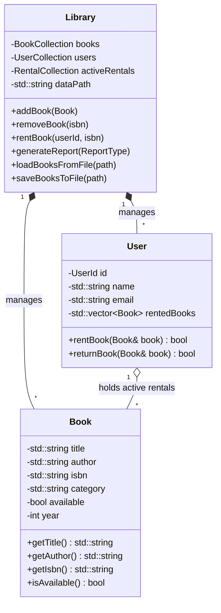

# 📚 CPPLibrary - Modern C++ Library Management System


**CPPLibrary** is a high-performance, object-oriented Library Management System written in **C++17**. It provides an interactive Command Line Interface (CLI) for managing book catalogs, user accounts, rental workflows, sorting operations, analytical reports, and file-based data persistence.

---

## 📋 Table of Contents

- [Features](#-features)
- [Architecture & Domain Model](#-architecture--domain-model)
- [Project Structure](#-project-structure)
- [Prerequisites & Requirements](#-prerequisites--requirements)
- [Building & Running](#-building--running)
- [Command Line Usage & Options](#-command-line-usage--options)
- [Data Storage Format](#-data-storage-format)
- [Reporting & Analytics](#-reporting--analytics)
- [Author & License](#-author--license)

---

## ✨ Features

### 📖 Book Catalog Management
- **CRUD Operations**: Add, search, inspect, and remove books from the library catalog.
- **Multi-Criteria Search**: Case-insensitive search by Title, Author, ISBN, or Category.
- **Dynamic Sorting**: Sort book lists by Title, Author, or Publication Year.
- **Data Validation**: Standard 13-digit ISBN format validation routines.

### 👤 User Administration
- **User Accounts**: Register and manage user profiles (`UserId`, Full Name, Email).
- **Search & Filtering**: Search active users by User ID or Email address.
- **User Sorting**: Organize user records by Name, Email, or number of currently rented books.
- **Email Validation**: Input checking for valid email address syntax.

### 🔄 Rental System
- **Checkout & Return Operations**: Rent available titles to registered users and process returns.
- **Inventory Tracking**: Real-time availability status tracking for catalog items.
- **Safety Checks**: Prevents double-renting or renting invalid/unavailable titles.

### 📊 Reporting & Data Analytics
- **Popular Books Report**: Analyzes active rental distributions to identify top-circulated titles.
- **User Activity Report**: Aggregates patron participation and active rental counts.

### 💾 Data Persistence & Configuration
- **Automatic Storage**: Loads catalog and user databases on startup; auto-saves state upon graceful exit.
- **CLI Configuration**: Support for `--data-path` to specify custom storage locations and `--admin` operational flag.
- **Directory Management**: Automatically creates target data directories if missing using C++17 `<filesystem>`.

---

## 🏗️ Architecture & Domain Model

The application is structured into domain namespaces (`LibrarySystem` and `LibraryUtils`) to ensure modularity and clean encapsulation.



---

## 📁 Project Structure

```
CPPLibrary/
├── include/
│   ├── book.h          # Book entity class declaration
│   ├── user.h          # User entity class declaration
│   ├── library.h       # Core Library manager, collections & reporting interface
│   ├── handlers.h      # Interactive CLI sub-menu module handlers
│   ├── menu.h          # Console UI menu rendering declarations
│   ├── utils.h         # String helpers, validation routines & custom sorting
│   └── constants.h     # System constants, defaults & type aliases
├── src/
│   ├── main.cpp        # Entry point & command line argument parser
│   ├── library.cpp     # Library engine business logic & file I/O implementation
│   ├── book.cpp        # Book class method implementations
│   ├── user.cpp        # User class method implementations
│   ├── handlers.cpp    # CLI prompt handlers for CRUD workflows
│   ├── menu.cpp        # Console UI rendering logic
│   └── utils.cpp       # Utility functions & validation definitions
├── data/
│   ├── books.txt       # Semicolon-delimited persistent book catalog
│   └── users.txt       # Semicolon-delimited persistent user database
└── README.md           # Project documentation
```

---

## ⚙️ Prerequisites & Requirements

- **C++ Compiler**: Fully compliant **C++17** compiler (`g++ >= 8.0`, `clang++ >= 7.0`, or MSVC 2019+).
- **Standard Library**: Requires standard `<filesystem>` header support.
- **Operating System**: Cross-platform (Linux, macOS, Windows).

---

## 🚀 Building & Running

### Using GCC / Clang

1. **Clone the repository:**
   ```bash
   git clone https://github.com/Karman1818/CPPLibrary.git
   cd CPPLibrary
   ```

2. **Compile the source code:**
   ```bash
   g++ -std=c++17 -I./include src/*.cpp -o library
   ```

3. **Execute the application:**
   ```bash
   ./library
   ```

---

## 🖥️ Command Line Usage & Options

`CPPLibrary` accepts optional command-line flags on invocation:

```bash
./library [options]
```

| Option | Argument | Description | Default |
| :--- | :--- | :--- | :--- |
| `--data-path` | `<path>` | Custom directory path for loading/saving data files | `./data/` |
| `--admin` | None | Enables administrative execution flag | Disabled |

#### Examples:
```bash
# Launch with custom data storage directory
./library --data-path ./custom_data/

# Launch in administrative mode
./library --admin
```

---

## 💾 Data Storage Format

Data is stored in human-readable plain text files using semicolon (`;`) delimiters:

### `books.txt`
```text
title;author;isbn;category;year
Ostatnie życzenie;Andrzej Sapkowski;9788375780635;Fantasy;1993
Solaris;Stanisław Lem;9788308073384;Science Fiction;1961
```

### `users.txt`
```text
name;email;id
Jan Kowalski;jan.kowalski@gmail.com;1001
Anna Nowak;anna.nowak@gmail.com;1002
```

---

## 📊 Analytics & Reports

The system provides an automated report generation engine (`ReportType` enum):
1. **Popular Books (`ReportType::POPULAR_BOOKS`)**: Ranks books based on current active checkout frequency.
2. **User Activity (`ReportType::USER_ACTIVITY`)**: Ranks patrons by total active rentals.

---

## 👨‍💻 Author & License

- **Author**: Marceli Karman ([@Karman1818](https://github.com/Karman1818))
- **License**: Released under the [MIT License](LICENSE).

